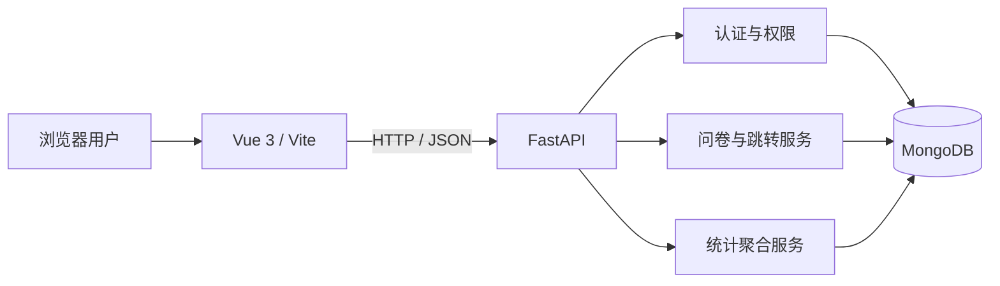

# 基于 MongoDB 的问卷系统

> 支持条件跳转、严格校验和实时统计的课程问卷系统。

## 项目简介

本项目是《当代数据管理系统》课程大作业一的完整实现。创建者可以管理、发布和关闭问卷，填写者登录后按动态路径逐题作答，系统以 MongoDB 保存问卷定义与答卷，并实时聚合统计结果。后端对权限、题型、跳转路径、截止时间和重复提交执行最终校验，前端负责编辑与交互反馈。

## 核心功能

- 账号注册、登录与 JWT 身份认证；
- 问卷草稿、题目、顺序、发布和关闭管理；
- 单选、多选、文本、数字四类题型；
- 单选、多选和数字条件跳转，仅允许向后跳转；
- 匿名展示、截止时间和重复提交策略；
- 选项计数、数字汇总、文本和原始答卷分页统计。

## 快速运行

### 环境要求

| 组件 | 最低要求 | 已验证版本 |
|---|---:|---:|
| Windows PowerShell | 5.1 | 5.1 |
| Python | 3.11 | 3.13.9 |
| Node.js | 22.12 | 24.19.0 |
| MongoDB Community Server | 7.x | 8.3.1 |
| mongosh | 建议安装 | 2.12.0 |

### 方式一：一键启动（推荐）

```powershell
powershell -NoProfile -ExecutionPolicy Bypass -File .\scripts\start-all.ps1
```

脚本会准备 `.env`、检查环境、按需启动工作区专用 MongoDB、安装缺失依赖，并启动 FastAPI 与 Vue。若不希望自动打开浏览器，追加 `-NoBrowser`。

### 方式二：手动启动

```powershell
# 终端 1：后端
Set-Location backend
python -m venv .venv
.\.venv\Scripts\python.exe -m pip install -r requirements.txt
.\.venv\Scripts\python.exe -m uvicorn app.main:app --reload --host 127.0.0.1 --port 8000

# 终端 2：前端
Set-Location frontend
npm install
npm run dev -- --host 127.0.0.1 --port 5173
```

手动启动前需确保 `.env` 指定的 MongoDB 已运行。

### 方式三：Docker Compose（可选）

```powershell
docker compose up --build
```

本地课程验收以一键脚本为默认方式；Docker 配置用于兼容部署。

## 访问地址

- 前端：`http://127.0.0.1:5173`
- Swagger：`http://127.0.0.1:8000/docs`
- OpenAPI：`http://127.0.0.1:8000/openapi.json`
- 存活检查：`http://127.0.0.1:8000/api/v1/health/live`
- 就绪检查：`http://127.0.0.1:8000/api/v1/health/ready`

## 配置说明

复制 `.env.example` 为 `.env` 后按需修改。`.env` 已被 Git 忽略。

| 配置项 | 默认值 | 说明 |
|---|---|---|
| `MONGODB_URI` | `mongodb://127.0.0.1:27017` | MongoDB 连接地址 |
| `MONGODB_DATABASE` | `survey_system` | 业务数据库名 |
| `MONGODB_TEST_DATABASE` | `survey_system_test` | Smoke 测试库，必须以 `_test` 结尾 |
| `MONGODB_TIMEOUT_MS` | `5000` | 数据库连接超时毫秒数 |
| `FRONTEND_ORIGINS` | 本地 5173 地址 | CORS 白名单，逗号分隔 |
| `JWT_SECRET` | 本地开发值 | 非本地环境必须替换为长随机值 |
| `JWT_EXPIRE_MINUTES` | `120` | 令牌有效期 |
| `VITE_API_PROXY_TARGET` | `http://127.0.0.1:8000` | Vite 的 `/api` 代理目标 |
| `BACKEND_PORT` | `8000` | Compose 后端映射端口 |
| `FRONTEND_PORT` | `5173` | Compose 前端映射端口 |

## 系统架构



## 项目结构

```text
.
├── backend/
│   ├── app/
│   │   ├── api/             # HTTP 路由与依赖
│   │   ├── core/            # 配置、安全与错误处理
│   │   ├── db/              # MongoDB Schema、连接、索引与演示数据
│   │   ├── repositories/    # 数据访问和所有权隔离
│   │   ├── schemas/         # API 输入输出模型
│   │   └── services/        # 校验、跳转和统计逻辑
│   └── tests/               # 单元测试与真实 MongoDB 集成测试
├── frontend/src/
│   ├── api/                 # API 客户端
│   ├── components/          # 通用组件
│   └── views/               # 注册、编辑、填写和统计页面
├── scripts/                 # Windows 检查与启动脚本
├── docs/                    # 提交文档与测试证据
├── .env.example             # 配置模板
└── docker-compose.yml       # 可选容器部署
```

## 测试

```powershell
Set-Location backend
.\.venv\Scripts\python.exe -m pytest -q

Set-Location ..\frontend
npm run build
```

集成测试只使用随机 `_test` 数据库，并在会话结束后删除该数据库。完整步骤、输入、输出和结果见 [测试用例](docs/test-cases.md)。

## 提交文档

| 文档 | 内容 |
|---|---|
| [系统说明](docs/system-design.md) | 范围、架构、模块、权限和运行流程 |
| [数据库设计](docs/database-design.md) | 集合 Schema、嵌入/引用策略、索引与一致性 |
| [API 说明](docs/api.md) | 接口、请求、响应、状态码和认证方式 |
| [关键逻辑说明](docs/key-logic.md) | 跳转重放、校验、并发防重和统计聚合 |
| [测试用例](docs/test-cases.md) | 测试步骤、输入、预期/实际输出与结果 |
| [项目完成报告](docs/final-report.md) | 目标、设计、AI 使用、测试、问题与解决方案 |

## 安全与数据保护

- 密码使用 Argon2 哈希，JWT 密钥由环境变量提供；
- owner 权限失败统一返回 404，避免泄露资源存在性；
- 禁止重复提交由 MongoDB 唯一部分索引兜底；
- MongoDB 集合验证器约束稳定存储结构，业务层校验跨字段规则；
- 启动和测试脚本不会清空默认业务数据库。
