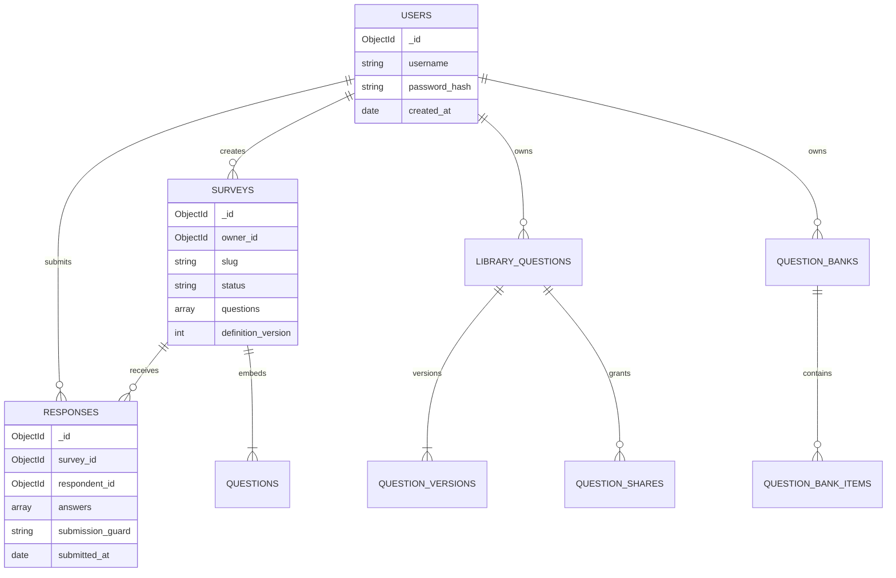

# MongoDB 数据库设计

## 1. 设计原则

默认数据库为 `survey_system`。第二阶段在 `users`、`surveys`、`responses` 之上增加 `questions`、`question_versions`、`question_shares`、`question_banks` 和 `question_bank_items`。问卷仍嵌入题目实例快照，以保证填写读取效率和发布后不可变；题目逻辑身份与不可变内容版本独立保存，支持复用、共享和历史追踪。

MongoDB 文档模型适合承载不同题型的异构 `validation`、`options` 和 `rules`。用户、问卷和答卷之间使用 ObjectId 引用，应用层负责权限与跨文档业务规则，数据库 Schema 负责稳定字段类型，索引负责唯一性和主要查询性能。

MongoDB 可执行 Schema 与索引均定义在 `backend/app/db/schema.py`。应用启动和演示数据脚本通过 `ensure_database_schema()` 幂等应用集合验证器与索引。

## 2. 集合关系



## 3. `users` 集合

```json
{
  "_id": "ObjectId",
  "username": "alice",
  "password_hash": "$argon2id$...",
  "created_at": "UTC Date"
}
```

必需字段：`username`、`password_hash`、`created_at`。系统只保存 Argon2 哈希，不保存明文密码。

## 4. `surveys` 集合

```json
{
  "_id": "ObjectId",
  "owner_id": "ObjectId(users)",
  "slug": "公开随机标识",
  "title": "课程体验调查",
  "description": "...",
  "allow_anonymous": false,
  "allow_multiple_submissions": false,
  "status": "draft | published | closed",
  "expires_at": null,
  "questions": [
    {
      "id": "q_xxx",
      "question_id": "ObjectId(questions)",
      "question_version_id": "ObjectId(question_versions)",
      "version_no": 2,
      "type": "single_choice | multiple_choice | text | number",
      "title": "...",
      "required": true,
      "options": [{"id": "opt_xxx", "label": "..."}],
      "validation": {},
      "rules": [{
        "priority": 1,
        "operator": "eq",
        "value": "opt_xxx",
        "target_question_id": "q_yyy"
      }]
    }
  ],
  "schema_version": 2,
  "definition_version": 1,
  "created_at": "UTC Date",
  "updated_at": "UTC Date",
  "published_at": "UTC Date | null",
  "closed_at": "UTC Date | null"
}
```

题目和选项使用稳定随机 ID，因此调整数组顺序不会破坏规则和统计引用。发布后冻结定义；`definition_version` 写入答卷，为后续不可变版本快照预留扩展点。

问卷内的 `id` 是跳转规则使用的局部实例 ID；`question_id` 是跨问卷稳定身份；`question_version_id` 指向不可变内容。`required` 和 `rules` 仅属于问卷实例。版本内容同时嵌入问卷作为快照，因此题目库产生新版本不会改变旧问卷。

## 5. 题目、版本、共享与题库集合

`questions` 保存所有者、当前版本和归档状态；`question_versions` 保存不可变内容、递增版本号、来源版本、创建者及修改说明。恢复旧版本等价于基于旧版本创建一个更高版本号的新文档。

`question_shares` 使用 `(question_id, grantee_user_id)` 唯一索引授予 `use` 权限。撤销共享只影响未来访问，已经嵌入问卷的快照不删除。

`question_banks` 保存题库元数据，`question_bank_items` 表达题库与题目的多对多关系，并记录题库推荐的 `default_version_id`。更新推荐版本不会修改任何问卷。

## 6. `responses` 集合

```json
{
  "_id": "ObjectId",
  "survey_id": "ObjectId(surveys)",
  "respondent_id": "ObjectId(users)",
  "definition_version": 1,
  "answers": [
    {"question_id": "q_xxx", "library_question_id": "ObjectId", "question_version_id": "ObjectId", "value": "opt_xxx"},
    {"question_id": "q_yyy", "value": ["opt_a", "opt_b"]},
    {"question_id": "q_zzz", "value": 88}
  ],
  "submission_guard": "<survey_id>:<respondent_id>",
  "submitted_at": "UTC Date"
}
```

允许重复提交时不写 `submission_guard`；禁止重复时写入稳定字符串。匿名语义是“对创建者隐藏身份”而非免登录，因此数据库仍保存 `respondent_id`，以执行认证与重复策略。

## 7. 索引设计

| 集合 | 索引 | 属性 | 用途 |
|---|---|---|---|
| `users` | `{username: 1}` | 唯一 | 防止重复用户名并支持登录查询 |
| `surveys` | `{slug: 1}` | 唯一 | 公开链接查询 |
| `surveys` | `{owner_id: 1, created_at: -1}` | 普通 | 创建者工作台倒序列表 |
| `responses` | `{survey_id: 1, submitted_at: -1}` | 普通 | 原始答卷分页和统计过滤 |
| `responses` | `{submission_guard: 1}` | 唯一部分索引 | 仅约束字符串 guard，并发防重 |
| `questions` | `{owner_id: 1, updated_at: -1}` | 普通 | 个人题目库列表 |
| `question_versions` | `{question_id: 1, version_no: 1}` | 唯一 | 版本号并发约束和历史查询 |
| `question_shares` | `{question_id: 1, grantee_user_id: 1}` | 唯一 | 防止重复共享 |
| `question_bank_items` | `{bank_id: 1, question_id: 1}` | 唯一 | 防止题库重复收录 |
| `surveys` | `{questions.question_id: 1, status: 1}` | 普通 | 反向查询题目使用情况 |
| `responses` | `{answers.library_question_id: 1, submitted_at: -1}` | 普通 | 跨问卷统计 |

## 8. 校验分层与一致性

- MongoDB `$jsonSchema` 校验稳定必需字段、BSON 类型、状态枚举和主要长度；
- Pydantic 校验 HTTP 输入的基本类型、长度和数组规模；
- 服务层校验题型约束、规则目标、顺序关系和实际访问路径；
- 发布后冻结定义，避免答卷和题目版本失配；
- 统计从原始答卷实时聚合，不维护可能过期的冗余计数；
- 日期统一保存为 UTC，并以 ISO 8601 返回 API。

## 9. 第一阶段数据迁移

`python -m app.db.migrate_phase2` 默认只预览；增加 `--apply` 后执行幂等迁移。每个旧问卷题目独立生成一个逻辑题目和 v1，不按标题猜测语义关系；问卷与旧答案回填引用后将 `schema_version` 升为 2。迁移使用唯一 `migration_key` 防止重试产生重复题目。

## 10. 测试与演示数据安全

集成测试只允许随机且以 `_test` 结尾的数据库，会话结束后只删除该随机库。演示脚本只接受 `_demo` 后缀，并只替换带阶段演示标记的数据。启动、Schema 初始化和索引初始化都不会清空业务集合。
