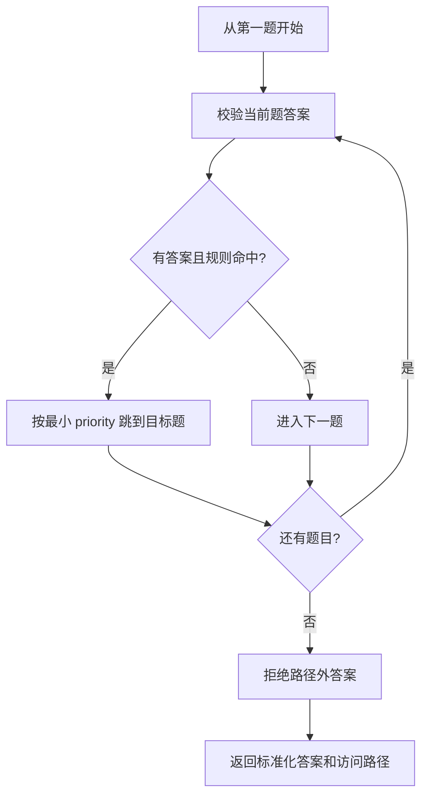

# 关键逻辑说明

## 1. 问卷发布校验

发布前由 `services/validation.py::validate_survey_definition` 一次性检查完整定义：

1. 至少包含一道题，题目与选项 ID 唯一且稳定；
2. 单选/多选至少两个选项，文本/数字题不能带选项；
3. 题型专属约束合法，例如最小值不能大于最大值；
4. 跳转运算符与题型匹配，条件值属于当前题；
5. 目标题存在且位于当前题之后，同一题的优先级不重复。

校验失败返回 HTTP 422 和结构化问题列表；通过后状态由 `draft` 变为 `published`，定义被冻结。

## 2. 条件跳转与路径重放

前端即时计算下一题以提供交互体验，并在前置答案变化时清理旧分支答案。后端不信任客户端提交的路径，而是调用 `services/rule_engine.py::replay_path` 从第一题重新执行。它拒绝重复题号、未知题号、路径外答案和循环/反向跳转，因此无法通过构造请求绕过必答或填写被跳过的题。

支持的条件：

| 题型 | 运算符 | 含义 |
|---|---|---|
| 单选 | `eq` | 等于指定选项 |
| 多选 | `contains_any` | 至少包含一个指定选项 |
| 多选 | `contains_all` | 包含全部指定选项 |
| 数字 | `eq`、`gt`、`gte`、`lt`、`lte` | 等于/大于/大于等于/小于/小于等于 |

## 3. 答案校验

`validate_answer` 按题型执行类型和边界检查：

- 必答题必须出现且不能是空值；
- 单选答案必须是现有选项 ID；
- 多选答案必须是无重复 ID 数组，并满足最少/最多选择数；
- 文本答案必须是字符串并满足长度范围；
- 数字答案必须是有限 JSON 数字，拒绝布尔值、数字字符串、NaN 和 Infinity，并检查整数与范围约束。

Pydantic 先限制请求形状和数组规模，业务校验再处理跨字段与路径语义，MongoDB Schema 最后保证稳定字段类型。

## 4. 权限、匿名与重复提交

- JWT 的 `sub` 保存用户 ObjectId；依赖函数每次从数据库读取当前用户；
- 管理接口查询条件同时包含问卷 ID 与 `owner_id`，越权与不存在均返回 404；
- 匿名问卷仍保存 `respondent_id`，但创建者查看答卷时不序列化身份字段；
- 禁止重复时生成 `survey_id:respondent_id` 形式的 `submission_guard`；MongoDB 唯一部分索引在并发请求下保证至多一份成功，而不是依赖不安全的“先查后写”。

## 5. 实时统计

统计不保存冗余汇总，而是从 `responses.answers` 聚合：

- 单选/多选：`$match → $unwind → $group` 计算各选项次数；
- 数字：`$avg`、`$min`、`$max` 计算均值和极值；
- 文本：汇总仅返回回答数，内容通过独立接口分页；
- 原始答卷：按 `submitted_at` 倒序分页。

这种设计保证统计和原始答卷一致；当前课程规模下实时聚合足够，数据量增长后可增加缓存或异步物化视图。

## 6. 错误与就绪语义

业务错误统一为 `code`、`message`、`details`。`live` 不访问数据库，用于判断进程是否存活；`ready` 每次执行 MongoDB `ping`，数据库不可用时返回 503，便于启动脚本和部署平台准确判断服务状态。
