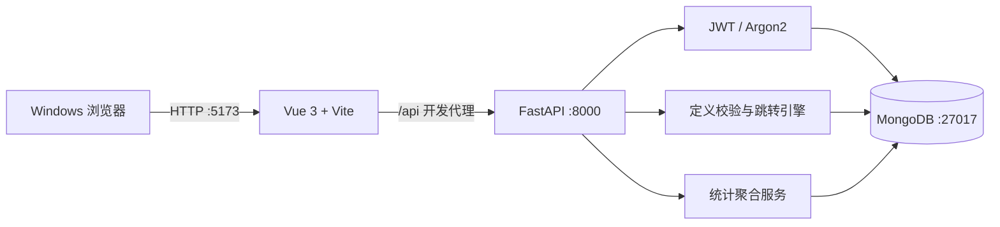

# 第一阶段系统设计与实现

## 范围

本阶段交付一个可演示的 MongoDB 问卷系统闭环：统一账号、问卷管理、四类题目、条件跳转、登录填写、匿名与重复控制、实时统计。本阶段不实现团队协作、文件上传、复杂权限层级、图表导出或问卷版本编辑。

## 架构

默认部署是 Windows 本地原生进程。`scripts/start-all.ps1` 可启动项目专用 MongoDB、FastAPI 和 Vite；容器配置保留为可选补充。

## 后端分层

- `app/api`：HTTP 路由、状态码和依赖注入；管理接口统一校验当前用户与 owner。
- `app/schemas`：Pydantic 输入边界；限制字符串长度、数组规模、日期和分页参数。
- `app/services/validation.py`：发布定义与四种题型答案校验。
- `app/services/rule_engine.py`：规则匹配和服务端路径重放。
- `app/services/statistics.py`：MongoDB 聚合统计。
- `app/repositories/surveys.py`：问卷查询和所有权隔离。
- `app/db/mongo.py`：连接生命周期和幂等索引。
- `app/core/security.py`：Argon2 哈希与 JWT。

FastAPI lifespan 在启动时创建 MongoClient、执行 ping、初始化索引，并在关闭时关闭客户端。`live` 不依赖数据库；`ready` 每次请求真实 ping，因此不会伪造就绪。

## 状态与权限

问卷状态为 `draft → published → closed`。草稿可编辑；发布会校验至少一题、题型配置、规则与目标并冻结定义；关闭后不能再提交。所有管理、统计接口只允许 owner，非 owner 返回 404，避免泄露资源存在性。公开定义和提交仍要求有效 JWT。

## 跳转语义

每题规则按 priority 升序取首个命中项；无命中时进入下一题。只允许向后跳转，从结构上消除循环。前端根据回答即时导航并允许返回修改；回答改变时清理不再位于当前路径的后续答案。后端不信任前端路径，会从第 1 题开始重放：

1. 验证题号无重复且都存在；
2. 验证当前路径题目的类型、必填与边界；
3. 执行第一个命中规则或顺序前进；
4. 拒绝访问路径之外的任何答案。

支持条件：单选等于、多选包含任一/全部、数字等于/大于/大于等于/小于/小于等于。

## 前端信息架构

- 注册/登录：统一账号入口和明确错误反馈；
- 工作台：显示当前用户问卷、状态、题数、分享和统计入口；
- 新建/编辑：基本设置、题目卡片、四题型约束、可视化跳转规则、预览、发布/关闭；
- 填写：每次显示一道题、进度、返回修改、路径复核和提交结果；
- 统计：总提交数、选择计数条、数字汇总、文本分页、原始答卷分页和匿名说明。

前端所有 API 都经 `api/client.js`，Bearer token 存入 localStorage；Vite 将 `/api` 代理到可配置后端。加载、空状态、校验错误、网络错误和 MongoDB 不可用都有可见状态，不使页面整体崩溃。

## 关键安全与可靠性设计

- 密码 Argon2id 哈希；JWT 有过期时间和可配置 secret。
- 所有数据库地址来自环境变量；`.env` 被忽略，示例不含真实密钥。
- 业务错误结构统一；日志和 API 不返回密码哈希。
- 禁止重复时使用 MongoDB 唯一索引，不依赖“先查后写”，可抵抗并发竞争。
- 匿名问卷只在创建者 API 层隐藏身份，内部仍保留策略执行所需标识。
- 测试库和演示库有后缀护栏；不清理默认库和其他项目数据。

## 实现取舍

第一阶段采用 PyMongo 同步驱动。FastAPI 当前业务量与课程演示规模下逻辑简单、测试直接，迁移异步驱动不会改善本阶段核心目标。发布后冻结定义，避免“已提交答卷对应哪个题目版本”的复杂迁移；`definition_version` 已保留，后续若开放发布后编辑，可新增版本快照而不破坏现有答卷。
