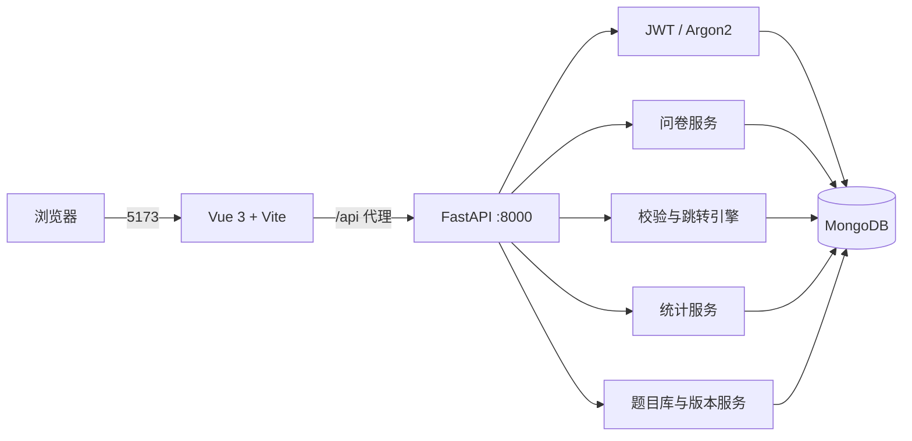
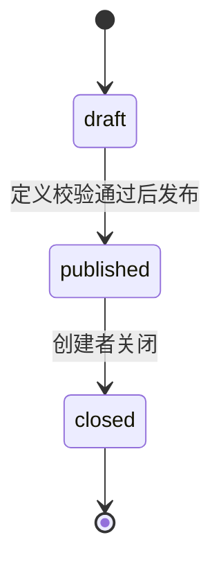
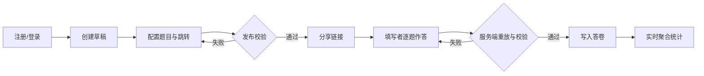

# 系统说明

## 1. 系统目标与范围

系统面向课程问卷的创建者和填写者，提供“维护题目库—设计问卷—发布链接—按条件填写—查看问卷及跨问卷统计”的完整闭环。第二阶段在原有四类题型、条件跳转和问卷统计之上，增加题目复用、只读共享、不可变版本、历史恢复、自定义题库和跨问卷匿名统计。

## 2. 总体架构

| 层级 | 技术 | 职责 |
|---|---|---|
| 前端 | Vue 3、Vue Router、Vite | 页面路由、问卷编辑、逐题填写、统计展示 |
| API | FastAPI、Pydantic | HTTP 接口、输入边界、身份与错误处理 |
| 业务 | Python services | 发布校验、路径重放、答案校验、统计聚合 |
| 数据 | PyMongo、MongoDB | 文档持久化、集合 Schema、索引和聚合 |

## 3. 后端模块

- `app/api`：把 HTTP 请求转换为业务调用，声明状态码和权限依赖；
- `app/core`：读取配置，处理 JWT、密码哈希和统一错误；
- `app/db/schema.py`：MongoDB 集合验证器和索引的单一事实来源；
- `app/db/mongo.py`：连接工厂以及 Schema/索引的幂等安装；
- `app/repositories`：对象 ID 解析、问卷查询和 owner 隔离；
- `app/schemas`：Pydantic 请求与响应边界；
- `app/services`：不依赖 HTTP 的校验、跳转与聚合逻辑。

FastAPI lifespan 建立 MongoClient，并尝试应用集合验证器和索引；数据库暂时不可用时进程仍可启动，但 `/health/ready` 返回 503。`/health/live` 仅表示进程存活。

## 4. 前端页面与路由

| 路径 | 页面 | 权限 |
|---|---|---|
| `/login`、`/register` | 登录、注册 | 游客 |
| `/dashboard` | 创建者工作台 | 已登录 |
| `/questions`、`/questions/:id` | 题目库、版本、共享、使用情况和跨问卷统计 | 已登录且具有题目访问权 |
| `/question-banks` | 自定义题库管理 | owner |
| `/surveys/new` | 新建问卷 | 已登录 |
| `/surveys/:id/edit` | 编辑、预览、发布与关闭 | owner |
| `/surveys/:id/statistics` | 统计与原始答卷 | owner |
| `/survey/:slug` | 逐题填写与提交 | 已登录 |

Vue Router 在进入受保护页面前检查本地 token；真正的身份、所有权和问卷状态始终由后端再次校验。

## 5. 问卷状态与权限

- 草稿可以修改基本信息、题目、顺序和规则；
- 题目正文修改会创建不可变新版本；必答和跳转规则仍是问卷实例设置；
- 草稿可显式选择或升级题目版本，已发布问卷永远保留发布快照；
- 发布后冻结定义，只允许修改截止时间或关闭；
- 关闭或到期后拒绝新答卷；
- 所有管理和统计接口仅允许 owner，越权统一返回 404；
- 公开问卷路径仍要求登录，匿名仅表示统计页面不展示填写者身份。

## 6. 典型业务流程

详细算法见 [关键逻辑说明](key-logic.md)，存储结构见 [数据库设计](database-design.md)。
