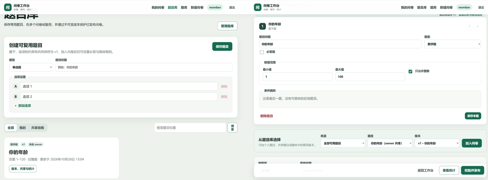
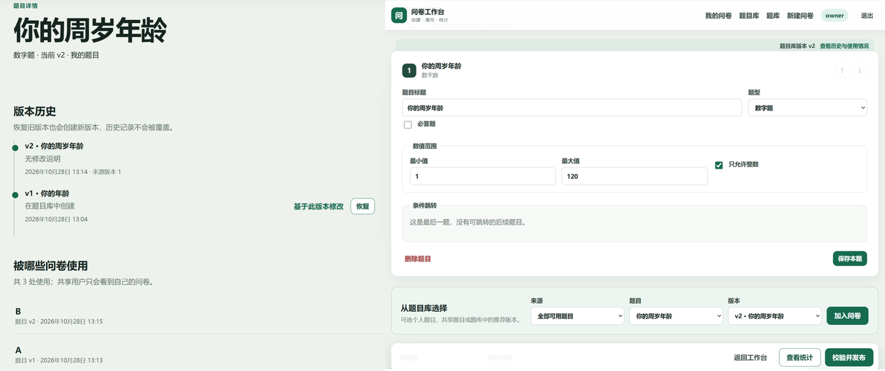
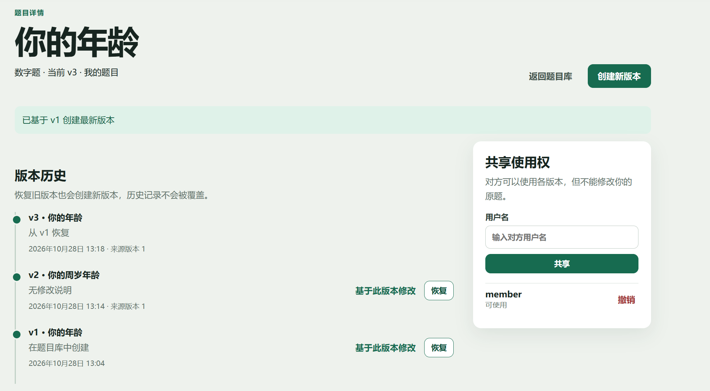
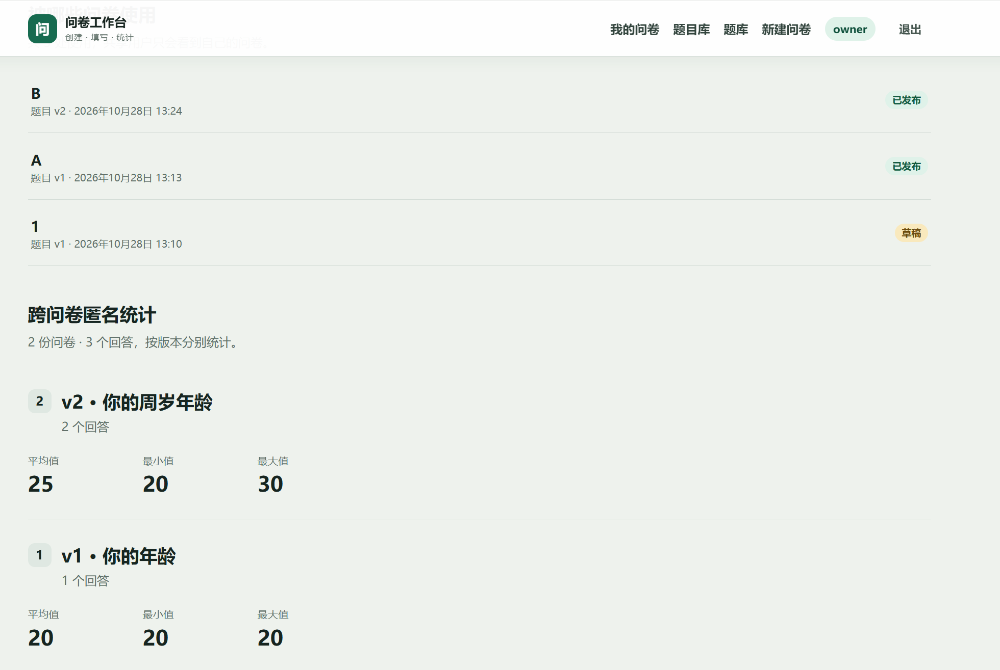

# 问卷系统第二阶段测试文档

文档日期：2026-10-28

测试范围：题目保存与复用、题目共享、发布问卷快照保护、版本历史与恢复、多版本共存、使用情况查询、题库管理、跨问卷题目统计。

测试方式：自动测试 + 手动测试

## 1. 测试环境

| 项目 | 配置 |
|---|---|
| 后端 | FastAPI 0.115.6、Python 3.11+ |
| 前端 | Vue 3、Vite 8.3.4 |
| 数据库 | MongoDB，默认 `mongodb://127.0.0.1:27017` |
| 自动测试 | pytest 8.3.4、FastAPI TestClient、真实 MongoDB |
| 数据隔离 | 每次测试生成随机且以 `_test` 结尾的数据库，结束后删除整个测试库 |

结果标记：

- `PASS`：已经执行，实际结果符合预期；
- `FAIL`：已经执行，但至少一项断言不符合预期；

## 2. 自动化测试执行结果

第二阶段专项测试文件：`backend/tests/integration/test_phase2_questions.py`。

### AT-01 保存题目并在多个问卷中复用

| 项目 | 内容 |
|---|---|
| 对应需求 | 需求一：保存常用题目 |
| 测试方法 | `test_requirement_1_save_and_reuse_question` |
| 测试步骤 | 创建题目“你的年龄”；创建问卷 A、B；分别从题目库加入同一道题；查询个人题目列表 |
| 核心断言 | 两个问卷实例拥有不同局部 ID，但 `question_id` 和 `question_version_id` 相同；个人题目列表能查询到该题 |
| 实际结果 | 所有断言通过 |
| 结果 | **PASS** |

### AT-02 共享题目给其他用户使用

| 项目 | 内容 |
|---|---|
| 对应需求 | 需求二：共享题目 |
| 测试方法 | `test_requirement_2_share_question_for_reuse` |
| 测试步骤 | 创建者按用户名共享题目；接收者查询“共享给我”；加入自己的问卷；创建者撤销共享 |
| 核心断言 | 接收者共享列表包含该题；可加入自己的问卷；撤销后不能再次访问原题，但已加入问卷的快照仍存在 |
| 实际结果 | 所有断言通过 |
| 结果 | **PASS** |

### AT-03 修改题目不影响已发布问卷

| 项目 | 内容 |
|---|---|
| 对应需求 | 需求三：修改不影响旧问卷 |
| 测试方法 | `test_requirement_3_edit_does_not_change_published_survey` |
| 测试步骤 | 将 v1 加入“去年问卷”并发布；在“今年问卷”中把题目改成新标题；读取去年问卷公开定义；尝试切换已发布问卷版本 |
| 核心断言 | 草稿编辑产生 v2；去年问卷仍显示 v1 标题和版本 ID；已发布问卷切换版本返回 HTTP 409 `SURVEY_FROZEN` |
| 实际结果 | 所有断言通过 |
| 结果 | **PASS** |

### AT-04 查询版本历史并恢复旧版本

| 项目 | 内容 |
|---|---|
| 对应需求 | 需求四：记录修改历史 |
| 测试方法 | `test_requirement_4_version_history_and_restore` |
| 测试步骤 | 创建 v1；基于 v1 创建 v2；恢复 v1；查询完整历史 |
| 核心断言 | 恢复操作生成 v3，而不是覆盖现有版本；v3 的 `parent_version_id` 指向 v1；历史按 v3、v2、v1 返回 |
| 实际结果 | 所有断言通过 |
| 结果 | **PASS** |

### AT-05 不同问卷同时使用不同版本

| 项目 | 内容 |
|---|---|
| 对应需求 | 需求五：多版本同时存在 |
| 测试方法 | `test_requirement_5_different_versions_coexist` |
| 测试步骤 | 创建“旧题”v1 和“新题”v2；问卷 A 选择 v1；问卷 B 选择 v2 |
| 核心断言 | A 显示 v1 和旧标题；B 显示 v2 和新标题；两者仍具有相同逻辑 `question_id` |
| 实际结果 | 所有断言通过 |
| 结果 | **PASS** |

### AT-06 查看题目使用情况

| 项目 | 内容 |
|---|---|
| 对应需求 | 需求六：查看被哪些问卷使用 |
| 测试方法 | `test_requirement_6_list_question_usages` |
| 测试步骤 | 将同一道题加入一份草稿和一份已发布问卷；调用使用情况接口 |
| 核心断言 | 返回两条使用记录；问卷标题准确；状态集合同时包含 `draft` 和 `published` |
| 实际结果 | 所有断言通过 |
| 结果 | **PASS** |

### AT-07 管理题库并更新默认版本

| 项目 | 内容 |
|---|---|
| 对应需求 | 需求七：建立题目库 |
| 测试方法 | `test_requirement_7_question_bank_and_default_version_update` |
| 测试步骤 | 创建题库；将题目 v1 加入题库；把推荐版本更新为 v2；重新查询题库 |
| 核心断言 | 初始默认版本为 v1；更新后为 v2；题库项目数为 1；详情返回新的默认版本 ID |
| 实际结果 | 所有断言通过 |
| 结果 | **PASS** |

### AT-08 单题跨问卷统计

| 项目 | 内容 |
|---|---|
| 对应需求 | 需求八：单题跨问卷统计 |
| 测试方法 | `test_requirement_8_cross_survey_question_statistics` |
| 测试步骤 | 创建年龄题 v1、v2；共享给另一用户；两个用户分别创建问卷并收集答案 20、40；查询题目统计 |
| 核心断言 | 所有者统计覆盖 2 份问卷、2 个回答；总体平均 30、最小 20、最大 40；直方图计数合计为 2；包含 v1、v2 分组；共享用户只能统计自己的 1 份问卷和答案 40 |
| 实际结果 | 所有断言通过 |
| 结果 | **PASS** |

## 3. 自动测试命令与实测记录

在项目根目录执行：

```powershell
# 第二阶段八项需求专项测试
Set-Location backend
..\.venv\Scripts\python.exe -m pytest tests\integration\test_phase2_questions.py -q -p no:cacheprovider

# 全量回归测试
..\.venv\Scripts\python.exe -m pytest tests -q -p no:cacheprovider
```

| 日期 | 测试范围 | 实际输出 | 结果 |
|---|---|---|---|
| 2026-10-28 | 第二阶段八项需求专项测试 | `8 passed` | **PASS** |
| 2026-10-28 | 后端完整单元与集成测试 | `57 passed` | **PASS** |

测试仅产生一条 Starlette TestClient/AnyIO 上游弃用警告，不影响业务断言和测试结果。

## 4. 手工测试准备

1. 在项目根目录启动系统：

   ```powershell
   powershell -NoProfile -ExecutionPolicy Bypass -File .\scripts\start-all.ps1
   ```

2. 浏览器打开 `http://127.0.0.1:5173`。
3. 准备三个账号：
   - 题目创建者：`phase2_owner`；
   - 共享接收者：`phase2_member`；
   - 问卷填写者：`phase2_respondent`。
4. 测试前记录账号密码；各账号用户名不能重复。
5. 以下用例执行后，在“实际结果”中填写页面表现、关键数据和异常信息，并将结果改为 `PASS` 或 `FAIL`。

## 5. 手工测试案例

### MT-01 创建并复用常用题目

| 项目 | 内容 |
|---|---|
| 对应需求 | 需求一：保存常用题目 |
| 前置条件 | 使用 `phase2_owner` 登录 |
| 测试步骤 | 1. 进入“题目库”。2. 创建数字题“你的年龄”，范围 0–120，只允许整数。3. 创建问卷 A，从题目库选择该题。4. 创建问卷 B，再次从题目库选择该题。5. 分别查看两份问卷 |
| 预期结果 | 题目库显示该题；A、B 均能选择并显示它；两份问卷中的题目可分别设置必答和跳转规则 |
| 实际结果 | 首次测试时，无法对创建的题目进行条件约束；修复后，可正常通过题目库创建题目，并在不同问卷里复用 |
| 结果 | **PASS** |


### MT-02 共享题目给其他用户

| 项目 | 内容 |
|---|---|
| 对应需求 | 需求二：共享题目 |
| 前置条件 | `phase2_owner` 已创建题目；`phase2_member` 已注册 |
| 测试步骤 | 1. 创建者打开题目详情。2. 输入 `phase2_member` 并共享。3. 退出并以接收者登录。4. 在题目库选择“共享给我”。5. 将共享题目加入接收者自己的问卷。|
| 预期结果 | 接收者能看到并使用共享题目，但不能修改原题 |
| 实际结果 | 接收者能看到并使用共享题目，在题目库里不能修改原题，将题目加入问卷后可以在问卷内灵活调整题目 |
| 结果 | **PASS** |



### MT-03 验证已发布问卷不受新版本影响

| 项目 | 内容 |
|---|---|
| 对应需求 | 需求三：修改不影响旧问卷 |
| 前置条件 | 题目“你的年龄”v1 已加入问卷 A，问卷 A 已发布 |
| 测试步骤 | 1. 复制并打开问卷 A 填写链接，记录题目文字。2. 返回题目详情并创建新版本，将标题改为“你的周岁年龄”。3. 再次打开问卷 A。4. 创建问卷 B 并选择新版本 |
| 预期结果 | 问卷 A 始终显示 v1 的“你的年龄”；问卷 B 可显示新版本；已发布问卷不出现升级或编辑按钮 |
| 实际结果 | 与预期结果一致，版本管理显示无误 |
| 结果 | **PASS** |



### MT-04 查看历史并恢复旧版本

| 项目 | 内容 |
|---|---|
| 对应需求 | 需求四：记录修改历史 |
| 前置条件 | 同一题目已经存在 v1、v2 |
| 测试步骤 | 1. 打开题目详情。2. 核对版本号、标题、时间、修改说明和来源版本。3. 对 v1 点击“恢复”。4. 刷新版本历史 |
| 预期结果 | 历史记录完整且顺序正确；恢复不会删除 v2，而是生成新的 v3；v3 标明来源为 v1 |
| 实际结果 | 与预期结果完全一致 |
| 结果 | **PASS** |



### MT-05 在不同问卷中选择不同版本

| 项目 | 内容 |
|---|---|
| 对应需求 | 需求五：多版本同时存在 |
| 前置条件 | 同一道题至少存在 v1、v2 |
| 测试步骤 | 1. 新建问卷 A，从题目库选择 v1。2. 新建问卷 B，从题目库选择 v2。3. 打开两份问卷的结构预览。4. 保存并刷新页面 |
| 预期结果 | A 显示 v1 内容，B 显示 v2 内容；刷新后版本选择不丢失；任一问卷的版本选择不影响另一份问卷 |
| 实际结果 | 与预期结果完全一致，两份问卷能够正确使用同一题目的不同版本 |
| 结果 | **PASS** |


### MT-06 查看题目被哪些问卷使用

| 项目 | 内容 |
|---|---|
| 对应需求 | 需求六：查看使用情况 |
| 前置条件 | 同一道题已用于至少一份草稿和一份已发布问卷 |
| 测试步骤 | 1. 打开该题详情。2. 找到“被哪些问卷使用”。3. 核对问卷名称、状态、版本和更新时间。4. 在草稿问卷升级题目版本后再次查看 |
| 预期结果 | 所有使用记录均被列出；草稿与已发布状态正确；草稿升级后使用版本同步更新；已发布记录不变 |
| 实际结果 | 与预期完全一致，问卷B发布后，状态从草稿变为已发布 |
| 结果 | **PASS** |


### MT-07 创建题库并更新推荐版本

| 项目 | 内容 |
|---|---|
| 对应需求 | 需求七：建立题目库 |
| 前置条件 | 个人或共享题目至少两道，其中一道存在新版本 |
| 测试步骤 | 1. 进入“题库”。2. 创建“人口学常用题”。3. 加入年龄题和性别题。4. 将年龄题默认版本更新到最新版。5. 新建问卷，从该题库选择年龄题。6. 从题库移出性别题 |
| 预期结果 | 题库正确显示两道题；年龄题推荐版本更新；从题库选题默认选择推荐版本；移出题库不删除原题和已有问卷中的题目 |
| 实际结果 | 与预期结果一致，题目发布新版本后可以在题库里手动同步 |
| 结果 | **PASS** |


### MT-08 查看单题跨问卷统计

| 项目 | 内容 |
|---|---|
| 对应需求 | 需求八：跨问卷统计 |
| 前置条件 | 年龄题用于问卷 A、B；至少提交年龄 20、30、40 三份回答，可跨 v1、v2 |
| 测试步骤 | 1. 打开年龄题详情。2. 查看“跨问卷匿名统计”。3. 核对问卷数、回答数、平均值、最小值、最大值和各版本分组。4. 以共享用户登录并查看同一题统计 |
| 预期结果 | 所有者看到自己及共享使用产生的匿名汇总；20、30 的平均值为 25、最小值 20、最大值 30；v1、v2 分开统计；不显示填写者身份和跨问卷文本原文；共享用户只看到自己问卷的数据 |
| 实际结果 | 与预期结果一致，题目不同版本的数据不会混淆 |
| 结果 | **PASS** |


