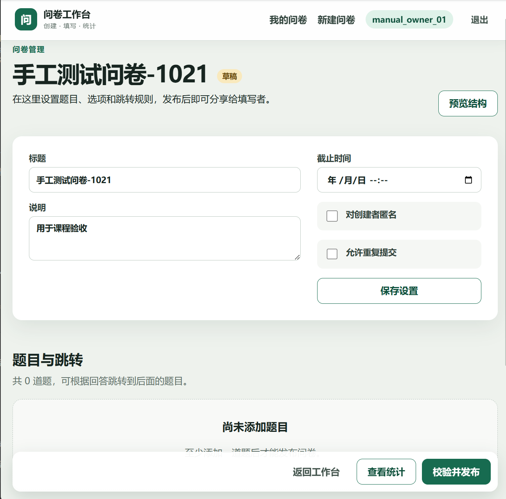
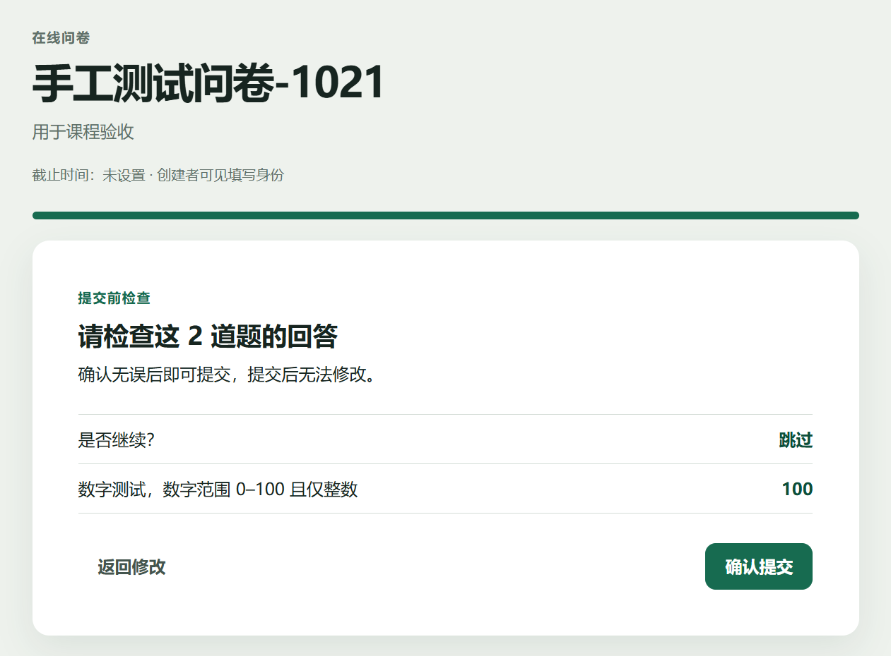
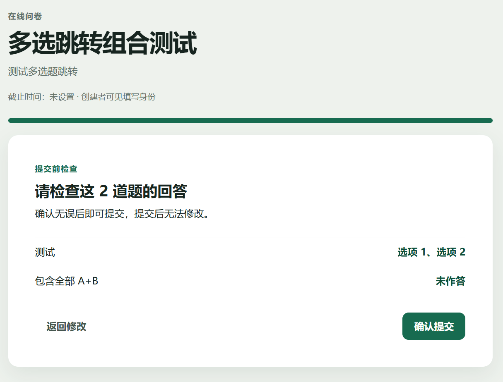
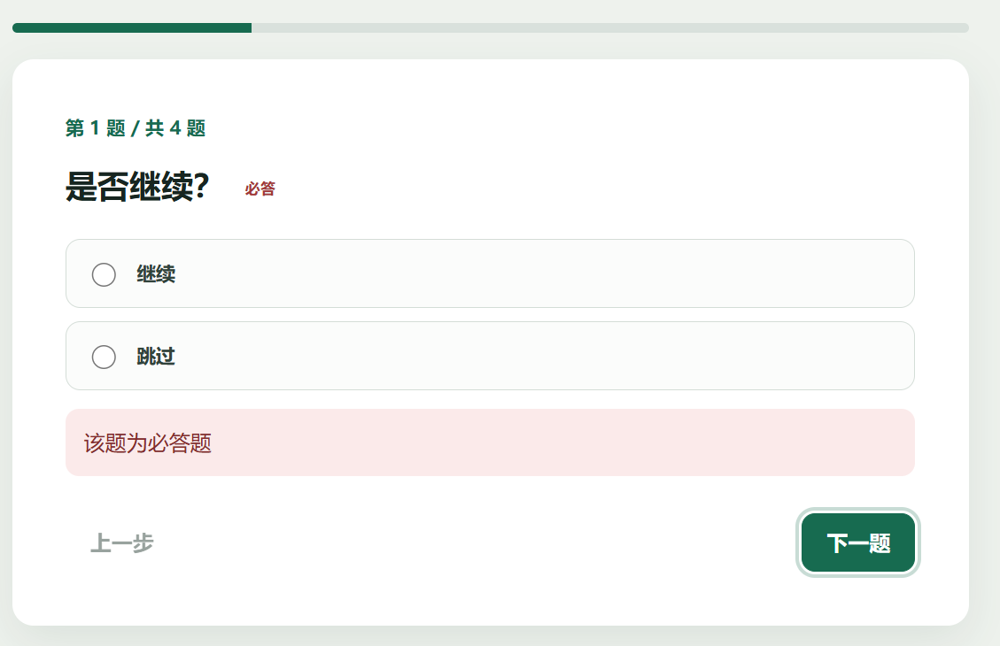
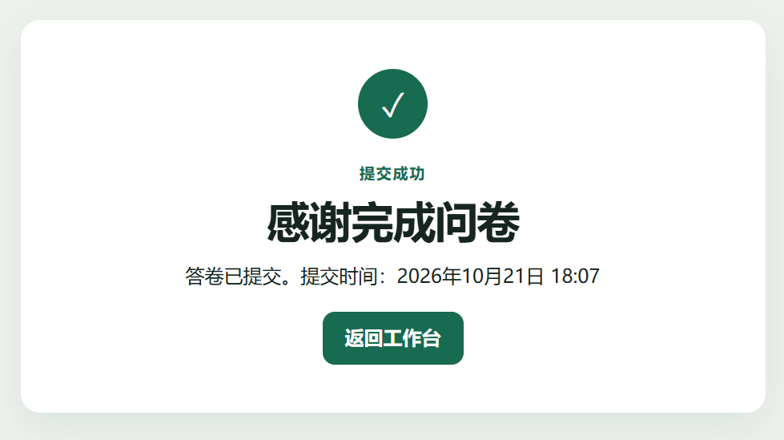
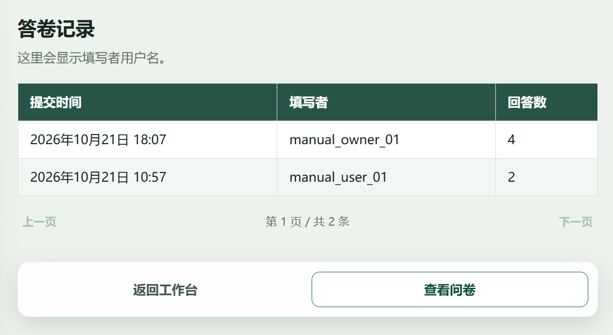
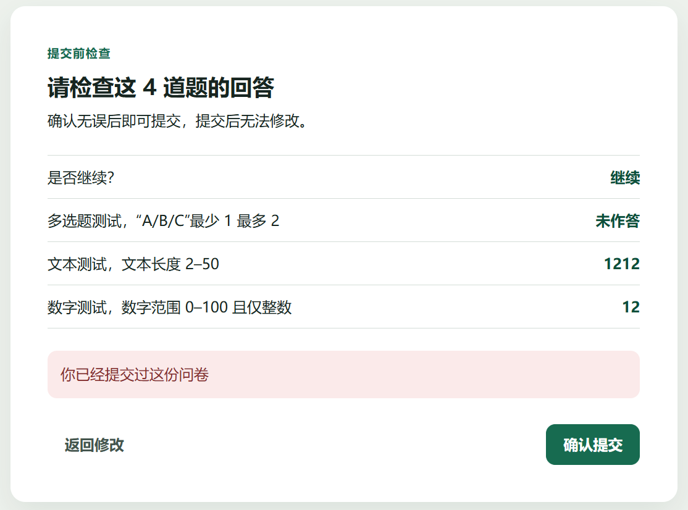
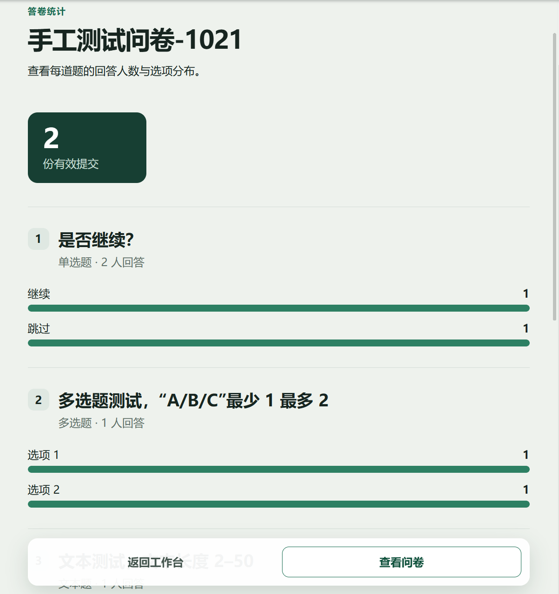

# 问卷系统测试用例与手工测试流程

文档日期：2026-10-21  
测试范围：创建问卷、添加题目、跳转逻辑、答案校验、提交问卷、统计结果。  
自动测试入口：`backend/tests/integration/test_required_cases.py`。

## 1. 测试环境与结果标记

- 后端测试框架：pytest 8.3.4 + FastAPI TestClient。
- 数据库：本机 MongoDB，默认地址 `mongodb://127.0.0.1:27017`。
- 数据隔离：自动测试每次生成名称以 `_test` 结尾的随机数据库，测试会话结束后自动删除；不会读写默认业务数据库。
- `PASS`：实际执行且结果符合预期。
- `FAIL`：实际执行但结果不符合预期。
- `NOT RUN`：尚未执行或受环境限制未执行。

## 2. 自动化 API 测试用例

### TC-A01 创建问卷

| 项目 | 内容 |
|---|---|
| 类型 | 自动化 API 集成测试 |
| 前置条件 | MongoDB 正常；用户已注册并登录，携带 Bearer Token |
| 测试步骤 | 1. 调用 `POST /api/v1/surveys`。2. 检查 HTTP 状态码。3. 检查返回的标题、状态、题目数和分享路径。 |
| 输入 | 标题“课程满意度调查”；说明“核心流程自动测试”；非匿名；禁止重复提交；无截止时间 |
| 预期输出 | HTTP 201；`status=draft`；`question_count=0`；`share_path` 以 `/survey/` 开头 |
| 实际输出 | HTTP 201，返回草稿问卷及有效分享路径 |
| 结果 | **PASS** |
| 对应代码 | `test_case_create_survey` |

### TC-A02 添加题目

| 项目 | 内容 |
|---|---|
| 类型 | 自动化 API 集成测试 |
| 前置条件 | 已创建草稿问卷 |
| 测试步骤 | 1. 调用 `POST /api/v1/surveys/{id}/questions`。2. 检查题型与选项。3. 检查题目 ID 和两个选项 ID。 |
| 输入 | 必答单选题“你是否满意？”；选项“满意”“不满意” |
| 预期输出 | HTTP 201；题型为 `single_choice`；题目和选项均获得非空稳定 ID |
| 实际输出 | HTTP 201，题目与两个选项均返回 ID，标签顺序正确 |
| 结果 | **PASS** |
| 对应代码 | `test_case_add_question` |

### TC-A03 跳转逻辑

| 项目 | 内容 |
|---|---|
| 类型 | 自动化 API 集成测试 |
| 前置条件 | 草稿含三题，第一题“跳过”选项配置为跳到第三题；问卷已发布 |
| 测试步骤 | 1. 添加单选题、文本中间题、文本末题。2. 为第一题添加 `eq` 跳转规则。3. 发布。4. 选择“跳过”，仅提交第一题和第三题。5. 检查服务端返回的访问题目列表。 |
| 输入 | 第一题答案为“跳过”的选项 ID；第三题答案“最终建议内容” |
| 预期输出 | HTTP 201；`visited_question_ids` 仅包含第一题和第三题，中间题不出现 |
| 实际输出 | HTTP 201，返回路径为第一题、第三题，中间题被正确跳过 |
| 结果 | **PASS** |
| 对应代码 | `test_case_jump_logic` |

### TC-A04 答案校验

| 项目 | 内容 |
|---|---|
| 类型 | 自动化 API 集成测试 |
| 前置条件 | 已发布一份含必答文本题的问卷；文本长度限制为 2–100 字符 |
| 测试步骤 | 1. 获取公开问卷。2. 提交仅含一个汉字的文本答案。3. 检查状态码、错误码和错误消息。 |
| 输入 | 文本答案“短” |
| 预期输出 | HTTP 422；错误码 `INVALID_ANSWER`；消息提示不能少于最小长度 |
| 实际输出 | HTTP 422，错误码及长度提示符合预期 |
| 结果 | **PASS** |
| 对应代码 | `test_case_answer_validation` |

### TC-A05 提交问卷

| 项目 | 内容 |
|---|---|
| 类型 | 自动化 API 集成测试 |
| 前置条件 | 已发布含必答文本题的非匿名问卷；填写者已登录 |
| 测试步骤 | 1. 调用公开提交接口。2. 检查返回的答卷 ID。3. 创建者查询答卷列表。4. 核对填写者用户名和答案。 |
| 输入 | 文本答案“希望增加案例” |
| 预期输出 | 提交 HTTP 201；答卷 ID 非空；列表总数为 1；用户名和答案与输入一致 |
| 实际输出 | 提交成功，创建者查询到 1 份答卷，身份和答案一致 |
| 结果 | **PASS** |
| 对应代码 | `test_case_submit_survey` |

### TC-A06 统计结果

| 项目 | 内容 |
|---|---|
| 类型 | 自动化 API 集成测试 |
| 前置条件 | 已发布含“满意/不满意”单选题的问卷；两个不同填写者账号可用 |
| 测试步骤 | 1. 填写者 A 选择“满意”并提交。2. 填写者 B 选择“不满意”并提交。3. 创建者请求统计接口。4. 核对总数、回答人数和选项计数。 |
| 输入 | 两份答卷，分别选择“满意”和“不满意” |
| 预期输出 | HTTP 200；`submission_count=2`；该题 `answered_count=2`；两个选项计数均为 1 |
| 实际输出 | 总提交数 2、回答人数 2、选项计数 1/1 |
| 结果 | **PASS** |
| 对应代码 | `test_case_statistics` |

## 3. 自动测试执行方法

在项目根目录打开 Windows PowerShell：

```powershell
# 先确认 MongoDB、Python 等环境
powershell -NoProfile -ExecutionPolicy Bypass -File .\scripts\check-env.ps1

# 只执行六个课程验收核心用例
Set-Location .\backend
.\.venv\Scripts\python.exe -m pytest -q tests\integration\test_required_cases.py

# 执行全部后端测试
.\.venv\Scripts\python.exe -m pytest -q

# 验证前端可以编译
Set-Location ..\frontend
npm run build
```

核心用例成功时显示 `6 passed`；完整套件成功时不应出现 failed 或 error。MongoDB 未启动时，集成测试会在 fixture 初始化阶段明确失败，不能将其记为通过。

## 4. 手工测试前置准备

1. 在项目根目录执行：

   ```powershell
   powershell -NoProfile -ExecutionPolicy Bypass -File .\scripts\start-all.ps1
   ```

2. 浏览器打开 `http://127.0.0.1:5173`。
3. 准备两个未使用的账号，例如：
   - 创建者：`manual_owner_01` / `ManualPass123!`
   - 填写者：`manual_user_01` / `ManualPass123!`
4. 测试问卷使用标题“手工测试问卷-日期时间”，避免与已有问卷混淆。

## 5. 手工测试用例

以下“实际输出”和“结果”由执行人测试时填写。本次仅编写流程，因此初始状态统一为 `NOT RUN`。

### TC-M01 创建问卷

| 项目 | 内容 |
|---|---|
| 测试步骤 | 1. 注册并登录创建者账号。2. 点击“新建问卷”。3. 填写基本信息。4. 点击“创建并添加题目”。 |
| 输入 | 标题“手工测试问卷-日期时间”；说明“用于课程验收”；不匿名；不允许重复提交 |
| 预期输出 | 进入问卷管理页；状态显示“草稿”；标题、说明和开关值与输入一致 |
| 实际输出 | 创建成功，进入问卷管理界面 |
| 结果 | **PASS** |



### TC-M02 添加四种题目

| 项目 | 内容 |
|---|---|
| 测试步骤 | 1. 依次添加单选题、多选题、文本题和数字题。2. 设置必答、选项与限制。3. 分别点击“保存本题”。4. 打开“预览结构”。 |
| 输入 | Q1 单选“是否继续？”选项“继续/跳过”；Q2 多选“A/B/C”最少 1 最多 2；Q3 文本长度 2–50；Q4 数字范围 0–100 且仅整数 |
| 预期输出 | 四题均保存；结构预览显示“单选题/多选题/文本题/数字题”，顺序和必答状态正确 |
| 实际输出 | 添加成功，结构预览显示“单选题/多选题/文本题/数字题”，顺序和必答状态正确 |
| 结果 | **PASS** |


### TC-M03 条件跳转

| 项目 | 内容 |
|---|---|
| 测试步骤 | 1. 在 Q1 添加规则：“等于 跳过”时跳到 Q4。2. 保存 Q1。3. 发布问卷并复制链接。4. 使用填写者登录并打开链接。5. Q1 选择“跳过”。 |
| 输入 | Q1=“跳过” |
| 预期输出 | 点击下一题后直接显示 Q4；Q2、Q3 不出现；提交前检查页只列出 Q1 和 Q4 |
| 实际输出 | 直接跳转Q4，提交前检查页只列出 Q1 和 Q4| 
| 结果 | **PASS** |



### TC-M04 多选跳转组合

| 项目 | 内容 |
|---|---|
| 测试步骤 | 1. 另建草稿，在多选题添加“包含全部 A+B”规则。2. 再添加“包含任一 A+C”规则，设置不同优先级。3. 保存后分别用 A+B、仅 A、仅 C、仅 B 测试。 |
| 输入 | 四组多选答案：A+B；A；C；B |
| 预期输出 | A+B 命中“包含全部”；A 或 C 命中“包含任一”；仅 B 不命中任一规则并顺序进入下一题 |
| 实际输出 | A+B 命中“包含全部”；C 命中“包含任一”；仅 B 不命中任一规则并顺序进入下一题 |
| 结果 | **PASS** |



### TC-M05 前端校验

| 项目 | 内容 |
|---|---|
| 测试步骤 | 1. 必答题不作答直接点击下一题。2. 多选题少选或超选。3. 文本题输入 1 个字符。4. 数字题输入小数或超出 0–100。 |
| 输入 | 空答案；多选 0 项或 3 项；文本“短”；数字 1.5 或 101 |
| 预期输出 | 页面停留在当前题并显示对应中文提示；不进入提交确认页 |
| 实际输出 | 必答题未作答时，显示“该题未作答”，无法进入下一题 |
| 结果 | **PASS** |



### TC-M06 提交问卷

| 项目 | 内容 |
|---|---|
| 测试步骤 | 1. 按合法路径完成所有可见必答题。2. 在提交前检查页核对答案。3. 点击“确认提交”。 |
| 输入 | Q1=继续；Q2=A+B；Q3=“课程内容清晰”；Q4=90 |
| 预期输出 | 显示“提交成功”和提交时间；创建者的答卷记录增加 1 条 |
| 实际输出 | 显示“提交成功”和提交时间；创建者的答卷记录增加 1 条 |
| 结果 | **PASS** |




### TC-M07 禁止重复提交

| 项目 | 内容 |
|---|---|
| 测试步骤 | 1. 保持问卷“不允许重复提交”。2. 使用同一填写者再次打开链接并提交第二份答卷。 |
| 输入 | 与首次相同或不同的一组合法答案 |
| 预期输出 | 第二次提交被拒绝并显示清晰错误；统计中的提交总数不增加 |
| 实际输出 | 第二次提交时，显示“不允许重复提交” |
| 结果 | **PASS** |



### TC-M08 统计页面

| 项目 | 内容 |
|---|---|
| 测试步骤 | 1. 创建者返回工作台。2. 点击该问卷的“统计”。3. 核对总提交数、各题回答人数、选项计数、数字平均/最小/最大和答卷记录。 |
| 输入 | 至少两份由不同账号提交的已知答卷，例如数字分数 80 与 100 |
| 预期输出 | 总提交数为 2；各选项计数与输入一致；数字平均值 90、最小值 80、最大值 100；非匿名问卷显示填写者用户名 |
| 实际输出 | 能够正确显示提交人与对应提交内容 |
| 结果 | **PASS** |




## 6. 本次自动测试实测记录

| 日期 | 命令 | 实际输出 | 结果 |
|---|---|---|---|
| 2026-10-21 | `.\.venv\Scripts\python.exe -m pytest -q tests\integration\test_required_cases.py` | `6 passed`；1 条 Starlette TestClient/AnyIO 上游弃用警告 | **PASS** |

